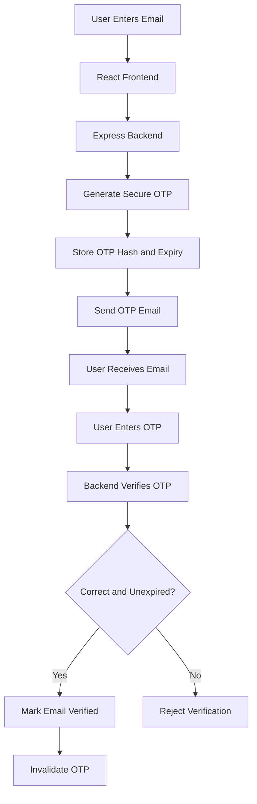
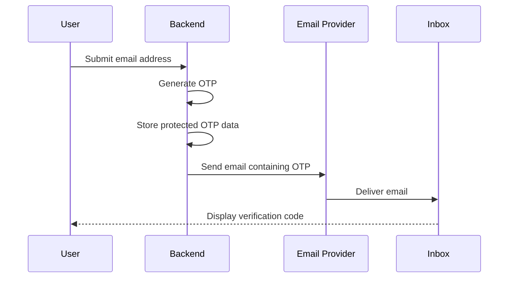
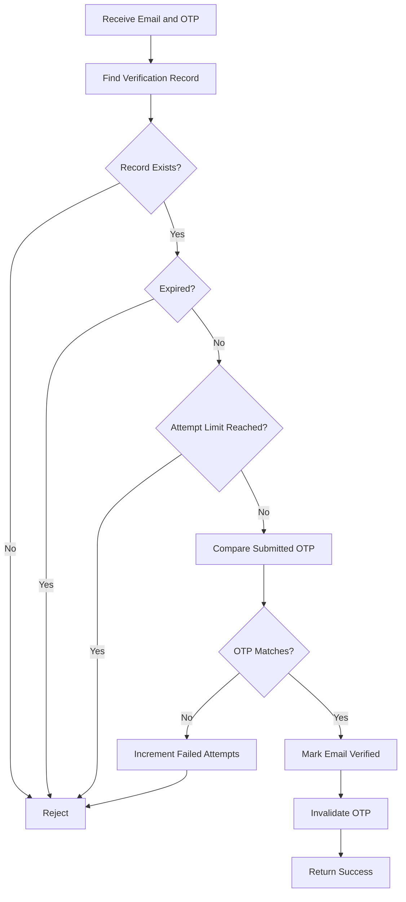
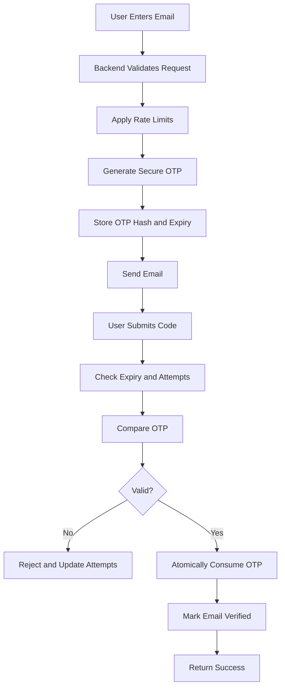

# 📧 Email OTP Verification

Email OTP (One-Time Password) verification is a security mechanism used to verify that a user can access a particular email inbox.


This section explains how to generate OTPs, deliver them through email, securely store verification data, validate submitted codes, and handle expiration and failed attempts using Node.js, Express, and MongoDB.

---

## 📑 Table of Contents

- [1. What Is Email OTP Verification?](#-1-what-is-email-otp-verification)
- [2. How OTP Verification Works](#-2-how-otp-verification-works)
- [3. OTP Generation](#-3-otp-generation)
- [4. Sending OTP Through Email](#-4-sending-otp-through-email)
- [5. Secure OTP Storage](#-5-secure-otp-storage)
- [6. OTP Verification Logic](#-6-otp-verification-logic)
- [7. OTP Expiration and Attempt Limits](#-7-otp-expiration-and-attempt-limits)
- [8. Backend API Examples](#-8-backend-api-examples)
- [9. Complete OTP Workflow](#-9-complete-otp-workflow)
- [10. Security Best Practices](#-10-security-best-practices)
- [11. Testing OTP Verification](#-11-testing-otp-verification)
- [12. Common Errors](#-12-common-errors)

---

## 🔐 1. What Is Email OTP Verification?

An OTP is a temporary code generated by the backend and delivered to a user's email address.

The user enters the received code into the application. The backend checks whether the submitted code is correct, has not expired, and has not already been used.

### Example

A user enters:

`user@example.com`

The backend generates a six-digit OTP:

`483921`

The email service delivers the code to the user's inbox. The user enters it into the application, and the backend verifies it.

**Important:** An OTP helps verify control of an email inbox. It does not, by itself, prove a person's real-world identity.

---

## 🔄 2. How OTP Verification Works

### Workflow diagram



### Step-by-step process

1. The user enters an email address.
2. The frontend sends the request to the backend.
3. The backend validates the request and applies rate limits.
4. The backend generates a secure OTP.
5. A protected representation of the OTP and its expiry time are stored.
6. An email service sends the actual code to the user.
7. The user submits the received code.
8. The backend validates the code and its expiration.
9. If valid, the backend marks the email as verified and prevents OTP reuse.

---

## 🔢 3. OTP Generation

OTP generation must happen on the backend using a cryptographically secure random generator.

### Example: Generate a six-digit OTP

```javascript
const crypto = require("node:crypto");

function generateOTP() {
  return crypto.randomInt(100000, 1000000).toString();
}

const otp = generateOTP();

console.log(otp); // Example: 483921
```

### Explanation

| Code | Purpose |
|---|---|
| `require("node:crypto")` | Imports Node.js cryptographic utilities |
| `crypto.randomInt(100000, 1000000)` | Generates a random six-digit integer |
| `.toString()` | Converts the code to a string |

Every invocation generates a new random code.

### Why not use `Math.random()`?

`Math.random()` is not designed for security-sensitive random values. Use Node.js `crypto.randomInt()` for OTP generation.

---

## 📩 4. Sending OTP Through Email

OTP generation and email delivery are separate operations.

The backend generates the code, while an email service delivers it to the recipient.

### Email delivery architecture



### Common email services

- **Nodemailer:** A Node.js library for sending email through SMTP.
- **Resend:** An API-based transactional email service.
- **Amazon SES:** A scalable email delivery service.

### Example: Send an OTP using Nodemailer

Install the package:

```bash
npm install nodemailer
```

Create an email utility:

```javascript
const nodemailer = require("nodemailer");

const transporter = nodemailer.createTransport({
  host: process.env.EMAIL_HOST,
  port: Number(process.env.EMAIL_PORT || 587),
  secure: false,
  auth: {
    user: process.env.EMAIL_USER,
    pass: process.env.EMAIL_PASS
  }
});

async function sendOTPEmail(email, otp) {
  return transporter.sendMail({
    from: process.env.EMAIL_FROM,
    to: email,
    subject: "Your Email Verification Code",
    text: [
      "Hello,",
      "",
      `Your verification code is ${otp}.`,
      "This code expires in 5 minutes.",
      "",
      "If you did not request this code, ignore this email."
    ].join("\n")
  });
}

module.exports = { sendOTPEmail };
```

This example uses SMTP configuration supplied through environment variables. Production configuration must match your provider's connection and authentication requirements.

### Example email

```text
Subject: Your Email Verification Code

Hello,

Your verification code is 483921.

This code expires in 5 minutes.

If you did not request this code, ignore this email.

Regards,
Your Application Team
```

---

## 🗄️ 5. Secure OTP Storage

The backend needs to retain verification information until the user submits the code.

For better security, avoid storing the original OTP in plaintext.

### Example database record

```json
{
  "email": "user@example.com",
  "otpHash": "<keyed-hmac-or-password-hash>",
  "expiresAt": "2026-10-12T10:05:00.000Z",
  "attempts": 0,
  "verifiedAt": null
}
```

*The example timestamp is illustrative.*

### Field descriptions

| Field | Purpose |
|---|---|
| `email` | Identifies the recipient |
| `otpHash` | Stores the protected representation of the code |
| `expiresAt` | Determines when the code becomes invalid |
| `attempts` | Tracks failed verification attempts |
| `verifiedAt` | Records successful verification when needed |

### Example: Calculate expiration time

```javascript
const expiresAt = new Date(
  Date.now() + 5 * 60 * 1000
);
```

This creates an expiration timestamp five minutes in the future.

### How should the OTP be hashed?

A keyed HMAC using a server-side secret or a suitable password-hashing algorithm can protect the stored OTP.

Because a six-digit OTP has only one million possible values, a plain unsalted hash is vulnerable to offline guessing if the database is leaked.

For a keyed HMAC, keep the secret outside the database and compare submitted codes using a timing-safe comparison. For bcrypt, use `bcrypt.compare()` to validate the submitted code against the stored hash.

---

## ✅ 6. OTP Verification Logic

OTP verification happens on the backend, not in the frontend.

The server checks the stored record, expiry, attempt limits, and submitted code before accepting verification.

### Verification flow



### Example: Compare the submitted code

```javascript
const bcrypt = require("bcrypt");

async function compareOTP(submittedOTP, otpHash) {
  return bcrypt.compare(submittedOTP, otpHash);
}
```

The backend must compare the submitted code with the stored hash and independently check the record's expiry and status.

### Example API request

```http
POST /api/auth/verify-otp
Content-Type: application/json
```

```json
{
  "email": "user@example.com",
  "otp": "483921"
}
```

### Example success response

```json
{
  "success": true,
  "message": "Email verified successfully"
}
```

### Example failure response

```json
{
  "success": false,
  "message": "Invalid or expired OTP"
}
```

The backend should invalidate the code after successful verification so that the same OTP cannot be used again.

---

## ⏱️ 7. OTP Expiration and Attempt Limits

OTP expiration reduces the period during which a stolen or intercepted code could be used.

Attempt limits reduce the ability to guess a six-digit code.

### Example configuration

| Setting | Example value |
|---|---|
| OTP length | 6 digits |
| OTP validity | 5 minutes |
| Maximum failed attempts | 5 |
| Resend cooldown | 30–60 seconds |
| Successful verification | Invalidate immediately |

These are example starting values, not universal security requirements.

### Example expiration check

```javascript
if (record.expiresAt <= new Date()) {
  throw new Error("OTP expired");
}
```

### Example attempt check

```javascript
if (record.attempts >= 5) {
  throw new Error("Too many verification attempts");
}
```

These snippets illustrate individual checks. In a real application, update attempt counts atomically and enforce the limits at the database or backend service level to prevent concurrent requests from bypassing them.

When issuing a replacement OTP, invalidate the previous code and enforce a resend cooldown.

---

## 🌐 8. Backend API Examples

A typical implementation may expose the following endpoints.

| Method | Endpoint | Purpose |
|---|---|---|
| `POST` | `/api/auth/send-otp` | Generate and send an OTP |
| `POST` | `/api/auth/verify-otp` | Verify the submitted OTP |
| `POST` | `/api/auth/resend-otp` | Request a replacement code |

### 8.1 Send OTP

**Request:**

```json
{
  "email": "user@example.com"
}
```

**Example response:**

```json
{
  "success": true,
  "message": "If the request is eligible, an OTP will be sent."
}
```

The backend should validate the email, enforce rate limits, generate the OTP, store the verification record, and send the email.

### 8.2 Verify OTP

**Request:**

```json
{
  "email": "user@example.com",
  "otp": "483921"
}
```

**Example response:**

```json
{
  "success": true,
  "message": "Email verified successfully"
}
```

### 8.3 Resend OTP

**Request:**

```json
{
  "email": "user@example.com"
}
```

The backend should check the resend cooldown, apply rate limits, invalidate the old code, and issue a replacement if the request is allowed.

These examples define an API contract; they do not represent a complete backend implementation.

---

## 🔄 9. Complete OTP Workflow

The following diagram combines the main steps into a single view.



### Component responsibilities

| Component | Responsibility |
|---|---|
| React | Collects email and submitted OTP |
| Express | Enforces verification rules |
| Database | Stores verification state |
| Email provider | Delivers the code |
| Authentication system | Controls access to protected operations |

---

## 🛡️ 10. Security Best Practices

- Generate OTPs using a cryptographically secure random generator.
- Store OTP hashes or keyed representations rather than plaintext codes.
- Enforce a short expiry period.
- Limit failed verification attempts.
- Apply resend cooldowns and request rate limits.
- Invalidate codes after successful verification or replacement.
- Ensure an OTP can be consumed only once.
- Validate input types and lengths on the backend.
- Avoid exposing account-existence information unnecessarily.
- Keep email credentials and hashing secrets in environment variables.
- Use HTTPS in production.
- Avoid logging OTPs, passwords, or sensitive tokens.
- Ensure that protected backend operations enforce the required verified-email status.

### Example environment variables

```dotenv
PORT=5000
MONGODB_URI=mongodb://localhost:27017/email_verification

EMAIL_HOST=smtp.example.com
EMAIL_PORT=587
EMAIL_USER=your-smtp-user
EMAIL_PASS=your-smtp-password
EMAIL_FROM=Your Application <noreply@example.com>
```

Never commit real credentials or secrets to GitHub. Use a sanitized `.env.example` file for documentation.

---

## 🧪 11. Testing OTP Verification

| Test case | Input or condition | Expected result |
|---|---|---|
| TC-01 | Correct, unexpired OTP | Verification succeeds |
| TC-02 | Incorrect OTP | Verification fails |
| TC-03 | Expired OTP | Verification fails |
| TC-04 | OTP record does not exist | Verification fails |
| TC-05 | Maximum failed attempts reached | Further attempts are rejected |
| TC-06 | OTP already used | Reuse is rejected |
| TC-07 | Resend requested too early | Request is throttled |
| TC-08 | Email delivery fails | Failure is handled without exposing the OTP |
| TC-09 | Concurrent verification requests | OTP is accepted at most once |
| TC-10 | Malformed OTP input | Request is rejected |

Tests should cover successful and unsuccessful paths, including race conditions and failures in external email delivery.

---

## ⚠️ 12. Common Errors

| Problem | Possible cause | Suggested check |
|---|---|---|
| Email not received | Incorrect SMTP credentials or delivery failure | Check provider logs and spam folder |
| OTP always fails | Incorrect hash comparison or mismatched records | Inspect verification logic without logging secrets |
| OTP expires immediately | Incorrect timestamp or timezone handling | Compare absolute timestamps |
| Old OTP still works | Previous code was not invalidated | Check replacement logic |
| Multiple attempts bypass limits | Non-atomic attempt updates | Enforce limits atomically |
| Email verified twice | Concurrent verification requests | Use atomic single-use consumption |
| Secrets appear in GitHub | `.env` accidentally committed | Remove secrets, rotate credentials, and update `.gitignore` |

---

<p align="center">
  <b>📧 Generate securely. Verify on the backend. Protect every verification attempt.</b>
</p>

<p align="center">
  Email OTP verification is one layer of a broader authentication and application-security strategy.
</p>
